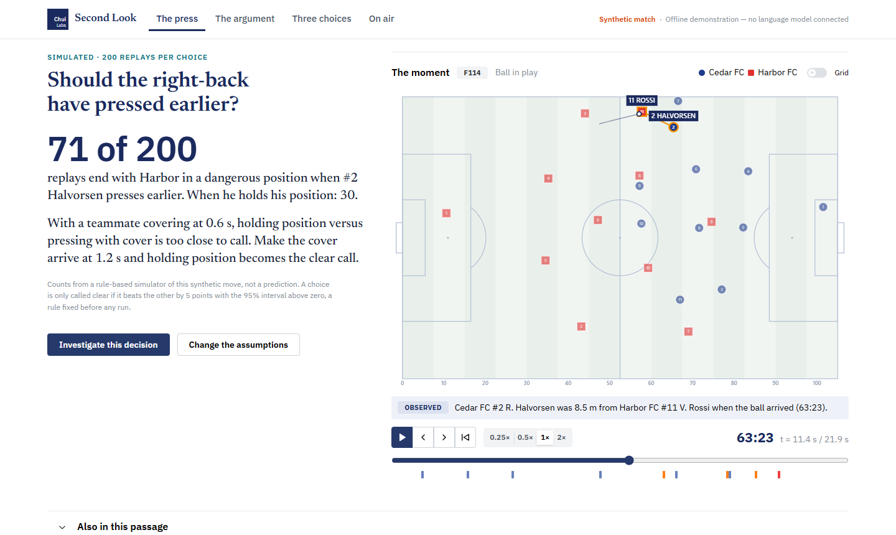
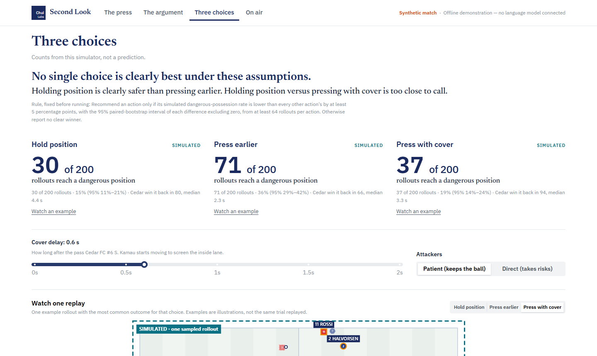

# Second Look

**Put your football opinions on the pitch.** By Chui Labs, for the Microsoft *Inside the Game* hackathon.

Football arguments ("should the right-back have pressed earlier?") usually hide their assumptions. Second Look makes one inspectable. You watch the moment, see the measured evidence, compare what *might* have happened under alternative choices in a transparent simulator, and see which assumptions change the answer.

In this move, pressing earlier lets the opponent into a dangerous position in **71 of 200** simulated replays, against **30** when the right-back holds. Pressing with a covering teammate (37) is too close to call against holding, until the cover arrives at 1.2 s instead of 0.6 s, when holding becomes the clear call.





**Live demo:** https://second-look-dusky.vercel.app. The hosted site runs the same tools and validator without a language model (offline mode, labelled on screen), so it never depends on a model being up. The live agents run on-device with Foundry Local; see Status. All data is **synthetic**. Cedar FC, Harbor FC and their players are fictional, and nothing is recorded from a real match.

## What it does

- **Replay.** A seeded 22-second synthetic sequence with all 22 players at 10 Hz, on a 2D pitch with play/pause/scrub/speed, a match clock, and clickable events.
- **The argument (ask & evidence).** Ask a question (8 supported types) and get claims that cite **typed facts**: observed measurements, labelled estimates, or simulation results. Every number is computed and rendered by code. Clicking a fact seeks the replay and draws the measurement on the pitch.
- **Three choices (what if?).** From the pass that triggered the press, a rule-based simulator replays the next 8 seconds 200 times for each choice (hold, press earlier, press with cover), with defenders and attackers reacting to each other.
  - Results are counts with 95% intervals.
  - A recommendation rule fixed before any run decides whether one choice is clearly best, or reports "no clear winner".
  - Sliders change the cover timing and attacker style. A **stress test** searches a fixed assumption grid for settings that flip the answer.
- **Agents (Microsoft Agent Framework).** Planner, evidence analyst, challenger and producer agents call the same tools. Agents choose which facts to show; code writes every factual sentence. The only free text the model writes is short interpretations, which may not contain numbers, certainty or causal wording, invented events, or comparisons between choices, and are rejected otherwise. One repair round, then a labelled fallback. Unknown players and what-ifs the simulator does not model are refused. Every answer has a "How this answer was made" trace.
- **Fan and analyst views** of the same facts, plus a **recap with a timed overlay export** (JSON) and a preview that plays the cues over the replay.

What it is **not**: a real-match tracking system, a judge of real players, or a calibrated predictor. The simulator is hand-set and not validated against real football (see [docs/MODEL_CARD.md](docs/MODEL_CARD.md)).

## Status (27 Oct 2026)

| Area | State |
|---|---|
| Replay, facts, evidence, simulator, challenger, What-if page, audience modes, recap/overlay | Built and tested; deployed |
| Agent Framework workflow (4 agents, validator, retries, fallback) | Built and tested through the real framework loop with scripted model replies |
| Live model, on-device (Foundry Local) | **Connected and verified locally.** The four agents run on `qwen3-8b` through Microsoft Foundry Local on the developer's laptop. Live test: 4 model calls, 3 tool calls, 4 claims approved, 0 rejected, about 83 s on an RTX 5070 laptop GPU. Also verified end to end in the UI. |
| Live model, cloud (Microsoft Foundry) | **Not connected.** A Foundry resource and project exist, but every model deployment on the available Azure for Students subscription was blocked by Azure error 715-123420. The public Vercel demo therefore runs in labelled offline mode. |
| Evaluation | 12 held-out variants: predeclared behaviour met 12/12; 139/139 injected fabrications rejected across 14 kinds; 36/36 off-catalogue questions refused ([docs/EVALUATION.md](docs/EVALUATION.md)) |

## Run it locally

Requirements: Python 3.12 and Node.js 20.19+ or 22.12+ (tested with Python 3.12.10 and Node 24.11.1 on Windows 11).

**Backend** (terminal 1):

```powershell
cd backend
py -3.12 -m venv .venv
.\.venv\Scripts\python.exe -m pip install -r requirements.lock
.\.venv\Scripts\python.exe -m pip install -e . --no-deps
.\.venv\Scripts\python.exe -m uvicorn app.main:app --host 127.0.0.1 --port 8000
```

On macOS/Linux, use `python3.12 -m venv .venv` and `.venv/bin/python` instead.

**Frontend** (terminal 2):

```powershell
cd frontend
npm ci
npm run dev
```

| What | URL |
|---|---|
| App | http://127.0.0.1:5173 |
| API health | http://127.0.0.1:8000/api/health |
| API docs (OpenAPI) | http://127.0.0.1:8000/docs |

**Optional: a live model on this device (Foundry Local, no Azure subscription).** Install it with `winget install Microsoft.FoundryLocal`, then run `foundry server start` and `foundry model load qwen3-8b`. In `.env` set `SECOND_LOOK_MODE=foundry_local`, `FOUNDRY_LOCAL_MODEL=qwen3-8b` and `INVESTIGATION_TIMEOUT_SECONDS=300`. A GPU is strongly recommended; one investigation takes 1–2 minutes on a laptop GPU.

**Optional: a live cloud Foundry model.** Copy `.env.example` to `.env` and set `SECOND_LOOK_MODE=foundry`, `FOUNDRY_PROJECT_ENDPOINT` and `FOUNDRY_MODEL_DEPLOYMENT`, then run `az login`. Authentication is Microsoft Entra ID only, with no API keys. Without these, the app runs in offline mode.

## Tests and evaluation

```powershell
cd backend;  .\.venv\Scripts\python.exe -m pytest -q   # 77 tests: data, metrics, leakage, simulator, agents, validator, exports
cd frontend; npm test                                  # replay interpolation / clock
cd frontend; npm run e2e                               # 11 browser tests (installed Edge; PLAYWRIGHT_CHANNEL to change)
backend\.venv\Scripts\python.exe scripts\evaluate.py   # held-out evaluation -> docs/EVALUATION.md
```

One live-model test is reported as **skipped** unless `SECOND_LOOK_LIVE_TESTS=1` and Foundry settings are present. To run the browser tests against a deployed site, set `E2E_BASE_URL=<url>`.

## How it is built

- **Backend:** Python 3.12, FastAPI, Pydantic, NumPy, Microsoft Agent Framework (`agent-framework-foundry`), azure-identity.
- **Frontend:** React 19, TypeScript, Vite, Mantine.
- **Deployment:** Vercel Services (frontend and API on one origin).

| Doc | Contents |
|---|---|
| [docs/ARCHITECTURE.md](docs/ARCHITECTURE.md) | Components, agent roles and handoffs, failure handling, versions |
| [docs/DATA_CARD.md](docs/DATA_CARD.md) | How the synthetic data is generated and validated |
| [docs/MODEL_CARD.md](docs/MODEL_CARD.md) | Every metric, the lane heuristic, the simulator, its calibration and limits |
| [docs/EVALUATION.md](docs/EVALUATION.md) | Held-out evaluation with real counts, plus what was not measured |
| [docs/DEMO_SCRIPT.md](docs/DEMO_SCRIPT.md) | Two-minute demo |
| [docs/BUILD_STATUS.md](docs/BUILD_STATUS.md) | Progress log, checks run, known limitations |

## Repository layout

```text
backend/    FastAPI app: data (generator, loader, validator), metrics + facts, simulation, investigations, agents, exports
            fixtures/development (served) and fixtures/evaluation (held out, never served)
frontend/   React app: canvas pitch with telestration, The press, The argument, Three choices, On air (recap and overlay), plus Players, Events, Methods
scripts/    generate_fixtures.py, evaluate.py
docs/       Architecture, data card, model card, evaluation, demo script, build status
```
